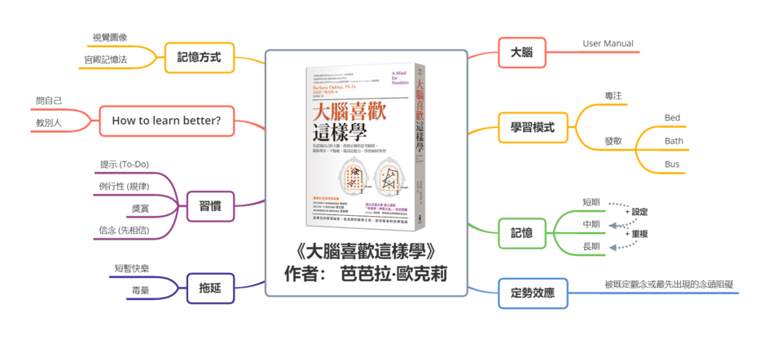
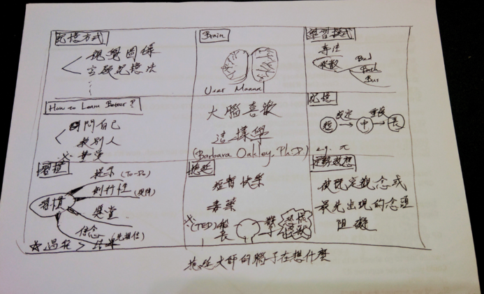

> 學習，是在動用大腦的兩種主要模式（專注模式與發散模式）。善用這兩者，才能學得好。—— Barbara Oakley

- 書名：《大腦喜歡這樣學》

- 作者：芭芭拉‧歐克莉

- 原文作者：Barbara Oakley

---

## 先來張心智圖吧！



[心智圖線上清晰版，歡迎點我～](http://www.xmind.net/m/2EmzMU)

- 大腦

    - User Manual
- 學習模式

    - 專注
        
    - 發散
        
        - Bed
        - Bath
        - Bus
- 記憶

    - 短期
    - 中期
    - 長期
- 定勢效應

    - 被既定觀念或最先出現的念頭阻礙
- 拖延

    - 短暫快樂
    - 毒藥
- 習慣

    - 提示（To-Do）
    - 例行性（規律）
    - 獎賞
    - 信念（先相信）
- How to learn better?

    - 問自己
    - 教別人
- 記憶方式

    - 視覺圖像
    - 宮殿記憶法

---

## 我們怎麼認識的？

起初是前同事強力推薦的，但買了一陣子後，某次讀書會才終於逼自己在一小時內看完，並做完簡略筆記，

謝謝身邊的推力！讓我這拖延症兼囤書症患者能有所進步 XD



---

## 我喜歡它嗎？

先講結論：**喜歡！**

滿滿知識點，作者會用簡單易懂的方式說明，不會覺得太生硬或枯燥乏味，

若有興趣還可再搭配 YouTube 或 Coursera 影片服用。

（作者有開 Learning How to Learn 的課程，重點是免費！）

補充：

[Coursera - Learning How to Learn by Barbara Oakley](https://www.coursera.org/learn/learning-how-to-learn)

---

## 它有什麼特別的？

先講作者，作者芭芭拉其實不是生來就天才，她一開始數學也不太好，

是在學習過程中，找到了正確的方法、了解並活用大腦，

才終於掌握理科，並於大學擔任教授。

（很有戲劇性吧！比起天才型學習者，好像又更有說服力了點）

分享四個書與我的化學反應（特別有感觸的點）

### 1\. 學習模式

以前曾有過寫程式怎麼想就是想不通的窘境，

午休趴在桌子上，一個靈光一閃，突然就想到解法，這是為什麼呢？

因為學習模式區分 **專注** 和 **發散** 兩種，當我陷入專注的狀態，

我所能思考到的點，也許就固定幾個，但解答可能剛好不在專注的路徑上，

當我準備休息時，大腦進入了發散的模式，反而引領我去到了不同的點。

常進入發散模式的情形，書中分享以下三種：

```
- Bed
- Bath
- Bus
```

馬上聯想到歐陽脩說的：

「最佳讀書時，乃為『三上』，即枕上、馬上、廁上。」

（原來阿脩也懂發散！）

### 2\. 定勢效應

簡言之就是被既定印象綁架，慣性思考或封閉思維，

舉個最近聽到的小故事：

警察局長在路邊與一位老人談話，這時跑過來一個小孩，

急忙地對警察局長說：「你爸爸和我爸爸吵起來了！！！」

老人問：「這孩子是你什麼人？」

警察局長說：「是我兒子。」

請問：這二個吵架的人跟警察局長是什麼關係？

答案：

你爸爸 → 警察局長爸爸

我爸爸 → 小孩爸爸

**警察局長是小孩的媽媽**

不知道你/妳是否有陷入定勢效應，我先承認我有！

為了避免這種情形常發生，即使對於自認熟悉的事情，

也要抱持著開放的心胸，去接受不同的可能性，

不要太仰賴經驗，希望自己維持這個心態持續學習！

### 3\. How to learn better

- 問自己（批判思考、反思）
- 教別人（費曼學習法，試著用簡單的方式說明）

教別人真的是很有效的輸出方式！期許自己能多多輸出！

補充：

費曼學習法（by 閱部客）：

<YT id="SLzn0LaR0lE" />

### 4\. 記憶方式

- 視覺圖像
- 宮殿記憶法

以前曾經學過一點記憶的技巧，以上兩種都是我很喜歡的記憶方式，

不只能記得清楚，也能記得比較久，甚至還能再搭配一些幽默的諧音梗等等。

補充：

記憶宮殿（by 金手指。成長學院）

<YT id="QtbiT1QI9vk" />

連作者本人都稱讚的超優書評（by SuperY超級歪）：

<YT id="iFSVMuBDMws" />

---

## 來點反饋嗎？

即使沒看過這本書，也期待你/妳能和我分享心得，

對於這篇文章，或者對於作者的其他作品等等，

期待能一起學習，一起進步！
