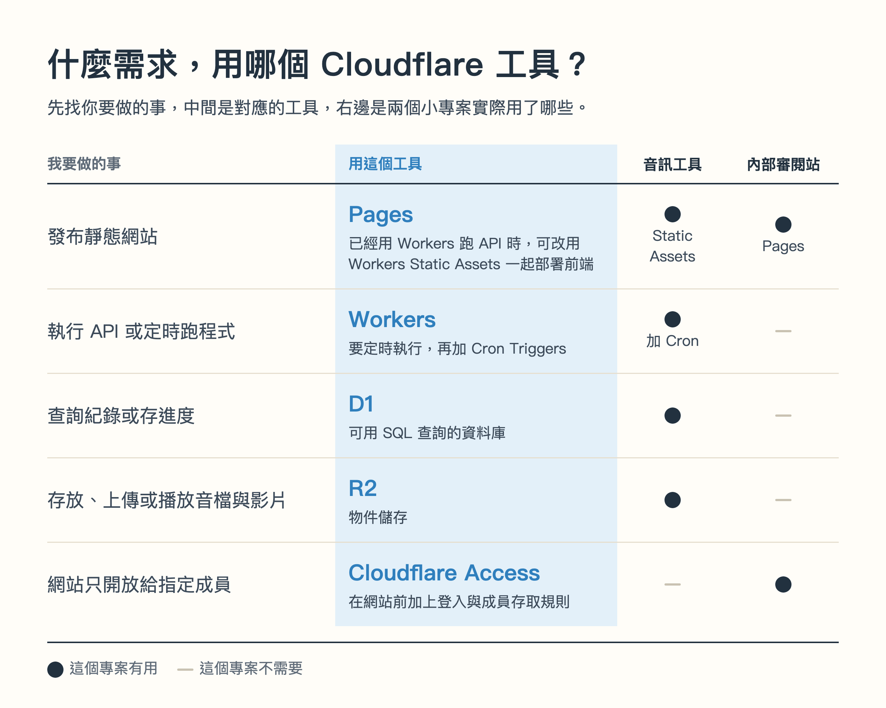

import Diagram from '../../components/diagrams/Diagram.astro';
import Box from '../../components/diagrams/parts/Box.astro';
import Arrow from '../../components/diagrams/parts/Arrow.astro';
import IdentityGatedEdge from '../../components/diagrams/IdentityGatedEdge.astro';

我用 Cloudflare 做了兩個用途很不一樣的小專案。一個可以上傳音檔、看逐字稿，還會在背景處理匯入和轉錄。另一個是給指定成員看的審閱站，部署好之後，能用 Cloudflare Access 控制誰可以進去。

我最喜歡的是第二個做法。審閱站本身只要產出靜態網頁，登入和權限規則交給 Cloudflare 管理。要開放給新成員時，可以直接調整 Access 規則，網頁也省去了自己做登入頁的工。

## TL;DR：什麼需求用哪個工具？

- **只要發布靜態網站** → **Pages**。如果專案已用 Workers 跑 API，也能用 **Workers Static Assets** 一起部署前端。
- **要執行 API 或定時跑程式** → **Workers**。要定時執行，再加 **Cron Triggers**。
- **要查詢紀錄或存進度** → **D1**。
- **要存放、上傳或播放音檔與影片** → **R2**。
- **網站只開放給指定成員** → **Cloudflare Access**。例如在靜態審閱站前加上登入與成員存取規則。



所以音訊工具用了 **Workers + D1 + R2**，另加排程處理背景工作。審閱站則用了 **Pages + Access**。兩個專案都透過 Wrangler 部署。[Wrangler 官方文件](https://developers.cloudflare.com/workers/wrangler/)

## 可複製的 AI 提示詞：幫我挑 Cloudflare 工具

想用免費工具做個小專案，可以直接複製這段，填入你想做的功能。知道每日使用人數、每月上傳量或誰需要登入的話，也一併附上，讓 AI 幫你挑工具、估算用量，再排出第一版的實作步驟。

```text
請根據我的專案需求，從有免費方案或免費額度的 Cloudflare 工具中，挑出足夠支援第一版的組合。

專案需求：[填寫要做什麼、使用者要完成哪些操作。若已知道預估人數、流量、檔案大小、保存時間或登入對象，也請填上。]

可評估的工具：
- Pages：發布靜態網站。
- Workers + Static Assets：執行 API，也能一起提供前端檔案。
- Cron Triggers：定時執行 Worker。
- D1：用 SQL 儲存、查詢結構化資料。
- R2：存放音訊、影片、圖片等檔案。
- Cloudflare Access（Zero Trust）：控制誰能登入和存取網站。
- Queues、Workers AI：有背景訊息處理或模型推論需求時再納入。

請用繁體中文回答：
1. 把需求和建議工具配對，說明每個工具負責什麼，以及哪些工具現階段可以先省略。
2. 用幾行說明請求會經過哪些服務，資料和檔案各放哪裡。
3. 依照我的使用情境估算是否能落在免費額度內。列出估算假設、最可能先碰到的限制，以及超出時會計費或停止服務。請附 Cloudflare 官方定價或限制文件連結。
4. 如果資料不足，先做有明確假設的初步建議，再列出哪些資訊可能改變選擇。
5. 給一份第一版的實作順序，列出要建立的資源、要接起來的功能，以及怎麼驗證主要流程可以運作。

先給我這份方案。等我確認選型之後，再依照實作順序開始開發。
```

## 一份音檔進來之後，資料分別放在哪裡？

打開音訊工具時，瀏覽器先載入 Workers Static Assets 提供的 HTML、CSS 和 JavaScript。要查節目或更新資料時，前端就呼叫 API，由 Worker 處理。原始音檔放進 **R2 物件儲存**，節目資料、音檔對應位置、逐字稿和處理進度則寫進 **D1 SQL 資料庫**。這樣一來，查詢節目清單或逐字稿時，可以直接查資料庫，等到使用者按播放才需要取用音檔。音檔傳輸也可以走有時效的簽名網址，讓瀏覽器直接和 R2 傳輸檔案。[Static Assets](https://developers.cloudflare.com/workers/static-assets/) · [D1](https://developers.cloudflare.com/d1/) · [R2](https://developers.cloudflare.com/r2/)

<Diagram title="Workers 接 API，D1 存逐字稿，R2 存音檔" description="瀏覽器呼叫 Workers API。Worker 查寫 D1 的節目與逐字稿資料，也能讀寫存放於 R2 的音檔。" height={288}>
  <Box x={112} y={14} w={176} label="瀏覽器" />
  <Arrow d="M200 64V104" travel={{ at: 0, cycle: 7 }} />
  <text className="dg-label dg-start" x="213" y="84">呼叫 API</text>
  <Box x={112} y={106} w={176} label="Workers" sub="處理 API 請求" strong />
  <Arrow d="M148 156V177H99V220" travel={{ at: 2, cycle: 7 }} />
  <Arrow d="M252 156V177H301V220" travel={{ at: 2, cycle: 7 }} />
  <text className="dg-label dg-start" x="109" y="201">查寫資料</text>
  <text className="dg-label dg-end" x="291" y="201">讀寫檔案</text>
  <Box x={20} y={222} w={158} label="D1" sub="節目、逐字稿、進度" />
  <Box x={222} y={222} w={158} label="R2" sub="原始與處理後的音檔" />
</Diagram>

轉錄需要在背景繼續跑。啟用雲端轉錄時，**Cron Triggers** 每分鐘會觸發一個背景 Worker，讓它檢查 D1 裡的待辦工作，接著處理一筆匯入工作或一段音訊。轉錄與 AI 功能會呼叫外部服務，相關用量由各服務另外計算。主 Worker 也有自己的排程，定期清理過期資料。外部服務的 API 金鑰則透過 Workers Secrets 提供給程式。[Cron Triggers](https://developers.cloudflare.com/workers/configuration/cron-triggers/) · [Workers Secrets](https://developers.cloudflare.com/workers/configuration/secrets/)

## 靜態網站也能只開放給指定的人嗎？

**Cloudflare Pages** 負責提供建置好的檔案。**Cloudflare Access** 則在檔案送到瀏覽器前，依登入身分和存取規則決定是否放行。用電子郵件一次性驗證碼（OTP）當例子，你可以指定哪些信箱有權限。受允許的人收到驗證碼、完成登入後，就能進入審閱站。團隊已有身分提供者時，也可以用既有的登入方式。[Cloudflare Access](https://www.cloudflare.com/products/access/) · [一次性驗證碼文件](https://developers.cloudflare.com/cloudflare-one/integrations/identity-providers/one-time-pin/)

<Diagram title="Access 驗證通過後才會放行到 Pages" description="訪客開啟審閱站時，Cloudflare Access 驗證身分並檢查存取規則。符合規則才會讀取 Pages 網站，未通過則無法讀取。" height={320}>
  <Box x={113} y={16} w={174} label="訪客" />
  <Arrow d="M200 66V106" travel={{ at: 0, cycle: 7 }} />
  <text className="dg-label dg-start" x="214" y="86">開啟審閱站</text>
  <Box x={87} y={108} w={226} h={58} label="Cloudflare Access" sub="驗證身分、檢查存取規則" strong />
  <Arrow d="M148 166V194H99V244" travel={{ at: 2, cycle: 7 }} />
  <Arrow d="M252 166V194H301V244" dashed />
  <text className="dg-label dg-start" x="110" y="221">符合規則</text>
  <text className="dg-label dg-end" x="290" y="221">未通過驗證或規則</text>
  <Box x={18} y={246} w={162} h={56} label="Cloudflare Pages" sub="讀取審閱站內容" />
  <Box x={220} y={246} w={162} h={56} label="拒絕存取" sub="頁面內容不會送出" />
</Diagram>

<figure class="post-figure">
  
  <figcaption>Cloudflare Access 的一次性驗證碼登入範例（<a href="https://developers.cloudflare.com/cloudflare-one/integrations/identity-providers/one-time-pin/#log-in-with-otp">Cloudflare 官方畫面</a>）</figcaption>
</figure>

部署審閱站時，我把登入檢查放進部署腳本。上傳檔案前，腳本會先用未登入的請求確認正式入口會轉去 Access。Pages 的 **正式網址和預覽網址** 要各自確認是否套用政策。如果另有自訂網域，也要確認該入口受保護。[Cloudflare Pages 的 Access 設定說明](https://developers.cloudflare.com/pages/platform/known-issues/#enable-access-on-your-pagesdev-domain)

## Zero Trust 怎麼決定要不要放行？

**NIST** 是美國國家標準與技術研究院（National Institute of Standards and Technology），隸屬美國商務部。它發布的 SP 800-207 說明 Zero Trust 的設計原則與架構分工。[NIST 官方介紹](https://www.nist.gov/about-nist)

Zero Trust 把權限綁在 **要存取的資源** 上。即使訪客連著公司 Wi-Fi，也要依身分、裝置狀態和該資源的政策決定能不能進入。以審閱站為例，最小權限可以從「只讓審閱成員讀取這個站」開始，其他內部工具各自有自己的政策。[NIST SP 800-207，〈Zero Trust Architecture〉](https://csrc.nist.gov/pubs/sp/800/207/final)

### 誰驗證身分，誰決定權限？

NIST 把這件事拆成三個邏輯角色。**政策引擎**（Policy Engine）用身分、裝置與政策做出決定。**政策管理元件**（Policy Administrator）把決定轉成建立或終止連線的指令。**政策執行點**（Policy Enforcement Point）在流量路徑上執行這些指令。三個角色描述的是分工，可以由同一套服務實作。[NIST SP 800-207，第 3 節](https://nvlpubs.nist.gov/nistpubs/SpecialPublications/NIST.SP.800-207.pdf#page=18)

放回審閱站來看，登入用的身分提供者（IdP）先確認你是誰，**Cloudflare Access 再判斷你能不能進這個站**，並在 Cloudflare 的邊緣節點執行結果。例如，一條允許政策可以讓指定信箱或群組符合 `Include`，再用 `Require` 要求使用指定登入方式或通過裝置檢查。預設拒絕，符合允許政策的人才能進入。[Access 政策](https://developers.cloudflare.com/cloudflare-one/access-controls/policies/) · [Cloudflare 身分驗證架構](https://developers.cloudflare.com/reference-architecture/architectures/identity-gated-edge/)

### 登入後，每次開頁面都要重新驗證嗎？

以瀏覽器為例，登入並符合政策後，Access 會簽發有期限的應用程式權杖（JWT），存在該站的 `CF_Authorization` Cookie。後續請求會自動帶上 Cookie，由 Access 檢查工作階段。權杖的簽章可供驗證，裡面的 `aud` 表明它是發給哪個應用程式，`exp` 記錄何時到期。[Authorization Cookie](https://developers.cloudflare.com/cloudflare-one/access-controls/applications/http-apps/authorization-cookie/) · [Application Token](https://developers.cloudflare.com/cloudflare-one/access-controls/applications/http-apps/authorization-cookie/application-token/)

<Diagram title="登入後，瀏覽器用有期限的權杖存取網站" description="Cloudflare Access 在登入且符合政策後簽發應用程式權杖。瀏覽器在後續請求帶上 Cookie。Access 檢查工作階段，通過後才讓請求抵達網站。" height={298}>
  <Box x={14} y={16} w={146} label="瀏覽器" />
  <Box x={228} y={16} w={158} label="Cloudflare Access" strong />
  <line className="dg-life" x1="87" y1="66" x2="87" y2="220" />
  <line className="dg-life" x1="307" y1="66" x2="307" y2="220" />
  <text className="dg-label" x="197" y="97">登入並通過政策</text>
  <Arrow d="M95 115H298" travel={{ at: 0, cycle: 8 }} />
  <text className="dg-label" x="197" y="146">簽發 JWT，設定 Cookie</text>
  <Arrow d="M298 164H95" dashed travel={{ at: 2, cycle: 8 }} />
  <text className="dg-label" x="197" y="195">後續請求帶上 Cookie</text>
  <Arrow d="M95 213H298" travel={{ at: 4, cycle: 8 }} />
  <Arrow d="M307 220V242" />
  <text className="dg-label dg-end" x="294" y="234">檢查通過</text>
  <Box x={228} y={244} w={158} h={42} label="讀取網站內容" />
</Diagram>

應用程式權杖到期時，若全域登入工作階段仍有效，且身分仍符合政策，Access 可以重新簽發權杖。全域工作階段也到期時，才會提示重新登入。檢查頻率也依條件而異，例如電子郵件是登入時取得的身分資訊，來源 IP 則可在工作階段中隨新請求重新評估。[工作階段管理](https://developers.cloudflare.com/cloudflare-one/access-controls/access-settings/session-management/) · [Access 政策條件](https://developers.cloudflare.com/cloudflare-one/access-controls/policies/#cloudflare-access-selectors)

執行點必須涵蓋所有能讀到資料的入口。以 Pages 來說，就是讓正式、預覽和自訂網域都套用相應政策。若改成有自架後端的應用，可以限制後端只接受經過授權入口的流量，並在後端驗證 Access 轉送的 JWT 簽章、發行者、適用的應用程式和有效期限。[Pages 的 Access 設定](https://developers.cloudflare.com/pages/platform/known-issues/#enable-access-on-your-pagesdev-domain) · [Cloudflare JWT 驗證文件](https://developers.cloudflare.com/cloudflare-one/access-controls/applications/http-apps/authorization-cookie/validating-json/)

### 如果把審閱站改成自架服務

原本的範例由 Pages 提供檔案。如果改成自架服務，可以用 **Cloudflare Tunnel** 把後端接到 Cloudflare，並關閉公網直接連到後端的入口。連接器 `cloudflared` 從自架環境向外建立通道。訪客請求先經 Access 審查，放行後才經 Tunnel 送到後端。[Cloudflare 身分驗證架構](https://developers.cloudflare.com/reference-architecture/architectures/identity-gated-edge/)

<IdentityGatedEdge />

**實線** 跟著網站請求走，**虛線** 表示登入交換或建立通道。在圖中的配置，`cloudflared` 會驗證 Access 轉送的 JWT，通過再交給應用程式。應用程式仍負責站內權限，例如同樣能登入的兩個人，可以分別只讀與編輯。[Cloudflare 信任邊界說明](https://developers.cloudflare.com/reference-architecture/architectures/identity-gated-edge/#trust-boundaries)

驗收時，可以把問題拆開。用未授權帳號確認受保護入口拒絕存取，再核對自己管理的後端只允許從預期路徑連入。若應用程式另有角色權限，也用不同角色確認各自能做的操作。[Cloudflare 部署驗收建議](https://developers.cloudflare.com/reference-architecture/architectures/identity-gated-edge/#four-design-requirements)

## 免費額度怎麼看？

以下是截至 2026 年 11 月 23 日查到的官方免費額度。不同服務分別看請求數、資料列、儲存量、建置次數或使用者人數。

<div class="quota-table">

| 工具 | 白話用途與免費額度 |
| --- | --- |
| **Workers<br />Static Assets** | Workers 負責執行程式，例如回傳搜尋結果。Static Assets 負責送出做好的網頁、樣式和圖片。<br />Workers 每天 10 萬次請求，每次呼叫的 CPU 時間上限為 10 毫秒。一般直接提供的靜態檔案免費且不限請求數，執行 Worker 程式的請求要計入用量。[Workers 定價](https://developers.cloudflare.com/workers/platform/pricing/) |
| **D1** | 像一套可用 SQL 查詢的表格，適合記錄節目名稱、逐字稿和處理進度。<br />每天讀取 500 萬列、寫入 10 萬列。帳號合計 5 GB，單一資料庫上限 500 MB。讀取量看查詢掃過的資料列數。[D1 定價](https://developers.cloudflare.com/d1/platform/pricing/) · [D1 限制](https://developers.cloudflare.com/d1/platform/limits/) |
| **R2** | 放音檔、影片和圖片的地方，程式可以按檔名和路徑取回整份檔案。<br />Standard 儲存每月含 10 GB-month、100 萬次 Class A 操作（例如上傳）及 1,000 萬次 Class B 操作（例如讀檔）。相當於存放 10 GB 一整月的額度，R2 傳到網際網路的流量免費。[R2 定價](https://developers.cloudflare.com/r2/pricing/) |
| **Pages** | 把做好的網頁發布成網站，例如部落格、作品集或內部文件。<br />每月 500 次建置，每站最多 2 萬個檔案，單檔上限 25 MiB。靜態檔案請求免費且不限量。若加上 Pages Functions，其請求與 Workers 共用每日額度。[Pages 限制](https://developers.cloudflare.com/pages/platform/limits/) · [Functions 定價](https://developers.cloudflare.com/pages/functions/pricing/) |
| **Cloudflare One<br />Zero Trust** | 用其中的 Access 替網站加上登入，只有符合規則的人才能讀取。<br />免費方案最多 50 位使用者，標準日誌最長保留 24 小時。[Cloudflare 方案比較](https://www.cloudflare.com/plans/) |

</div>

### 10 GB 大概能存幾部影片？

如果一部影片是 **500 MB**，R2 的 10 GB-month 大約能存 **20 部一整個月**。每部只有 **100 MB**，就大約是 **100 部**。也可以用碼率估算。假設影片的影音總平均碼率是 **4 Mbps**，1 小時大約是 **1.8 GB**，10 GB 大約可以存 **5.5 小時**。這些數字用十進位的 GB 和 MB 估算，實際以匯出後的檔案大小為準，音檔也可以用一樣的方式換算。[R2 定價與計費範例](https://developers.cloudflare.com/r2/pricing/)

**GB-month** 用一個計費週期內每天的最高儲存量來算平均。以 30 天為例，15 天各存 20 GB，另外 15 天都是 0 GB，容量用量就是 10 GB-month。讀取或上傳仍會用掉各自的操作額度。Pages 的 **25 MiB** 則是單一檔案上限，一部 100 MB 的影片已超過。可以把影片放 R2，由 Pages 提供播放介面。[R2 定價](https://developers.cloudflare.com/r2/pricing/) · [Pages 檔案限制](https://developers.cloudflare.com/pages/platform/limits/#file-size)

### 請求、資料列和人數怎麼換算？

- **Workers**。如果平均每次造訪會呼叫 API 5 次，2 萬次造訪就會用掉 10 萬次請求。實際也要把背景請求等其他流量算進去。[Workers 定價](https://developers.cloudflare.com/workers/platform/pricing/)
- **D1**。假設一個查詢每次掃過 1,000 列，執行 5,000 次就會用掉 500 萬列的每日讀取額度。影片本體的容量則看 R2 等檔案儲存服務。[D1 定價與資料列定義](https://developers.cloudflare.com/d1/platform/pricing/)
- **Pages**。如果一天觸發 10 次建置，一個 30 天的月份會用掉約 300 次。訪客讀取靜態頁面的請求免費且不限次數。[Pages 建置限制](https://developers.cloudflare.com/pages/platform/limits/#builds) · [靜態請求定價](https://developers.cloudflare.com/pages/functions/pricing/#static-asset-requests)
- **Zero Trust**。10 位審閱者使用 10 個身分，對應的是 50 位使用者額度中的 10 位。同一人一天開 20 次頁面，仍算同一位使用者。[Cloudflare 方案比較](https://www.cloudflare.com/plans/)

Cloudflare 還有 **Workers AI** 和 **Queues**。Workers AI 提供模型推論，每天有 10,000 Neurons 的免費配置，實際能處理多少請求取決於模型和用量。Queues 適合讓背景程式接收訊息並重試，免費每天 1 萬次操作，一則訊息的寫入、讀取和刪除各會計入。音訊工具這次採用的架構是由排程從 D1 領取工作，再呼叫模型服務。[Workers AI 定價](https://developers.cloudflare.com/workers-ai/platform/pricing/) · [Queues 定價](https://developers.cloudflare.com/queues/platform/pricing/)

下次做小工具，我會先看兩件事。網站只需要送出靜態檔案，Pages 就能做。要提供 API、保存資料或定時跑程式，再看 Workers、D1 和 R2。至於誰能進網站，可以單獨用 Access 決定，這也是我最想在下一個內部工具沿用的做法。
