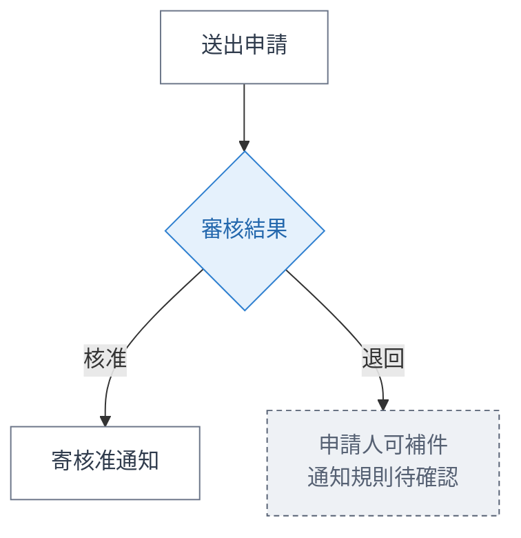

拿到一段需求，我會先寫下讀者想回答的問題。只要換一個問題，即使手上的資料完全相同，也可能需要另畫一張圖。

假設你要交接一個申請審核功能。申請人送件後進入審核，核准就寄通知，退回則可補件。文件寫著「審核完成就發通知」，但沒說退回時是否也會寄。這個小例子，可以拿來練習兩種圖。

## 看下一步，畫流程圖

客服想知道「申請人收到審核結果後，可以做什麼？」把核准與退回放在不同路徑，下一步就有了位置。退回的通知規則仍待確認，可以直接寫在這條支線旁。

如果只看圖，客服能回答「退回後可以補件」，也看得出哪條通知規則要再問產品團隊。

## 查誰看見什麼，畫矩陣

接著換成另一個問題。「在每個審核狀態下，申請人和客服各會看到什麼？」這時把狀態放在列、角色放在欄，就能直接查到交會的那一格。

| 目前狀態 | 申請人畫面 | 客服畫面 |
| --- | --- | --- |
| 送件後 | 審核中 | 待審 |
| 核准 | 已核准 | 已核准 |
| 退回 | 請補件 | 文案待確認 |

流程圖標出 **系統何時寄信**，矩陣列出 **畫面顯示什麼**。把問題放在各自對應的圖上，討論時就知道要回頭補哪一條規則。

## 用一個問題檢查圖

拿下一張要用來溝通的圖，請讀者只看圖回答一個問題，例如「案件退回時，申請人接下來能做什麼？」如果他在箭頭或標籤前停住，先改那裡。也可以換個人再問一次，看看兩人是否讀出同一個答案。

這篇練習參考高野雄一《圖像化思考的技術》中按資訊關係選圖、畫完回看再修的做法。[書籍介紹](https://www.books.com.tw/products/0011061749)
