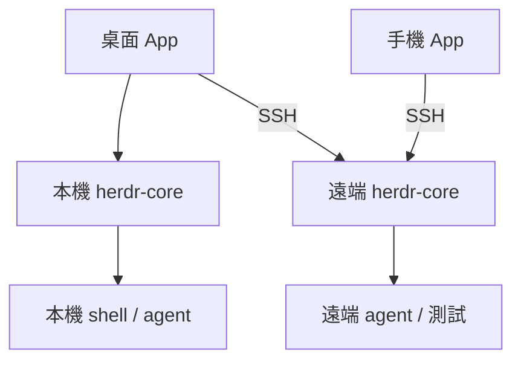
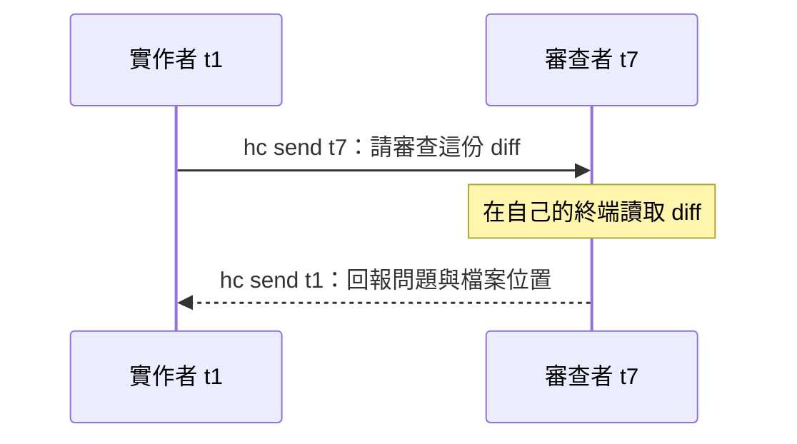

import { Image } from 'astro:assets';
import inbox from '../../assets/posts/herdr-inbox.webp';

一邊讓 Codex 寫功能，一邊請 Claude Code 做 code review，再開一個終端跑測試。工作一多，我最想知道兩件事：現在誰在等我？我關掉視窗之後，正在跑的工作還會繼續嗎？

我最喜歡 Herdr 的兩點，就是可以關掉視窗、晚點回來接著做，以及讓不同終端裡的 agent 直接交接。這篇以官網的 **Herdr App** 為主，也會說明原版 **Herdr TUI** 怎麼做同樣的事。

## TL;DR

- **關掉視窗可以繼續跑。** App 把終端交給 `herdr-core`，TUI 則有自己的 server。執行工作那台機器要保持運作。
- **Agent 可以直接交接。** App／Core 用 `hc send` 把訊息送進另一個終端。TUI 可用 `herdr --session <名稱> agent prompt` 指定另一個本機 session。
- **可以先看誰需要你。** 支援狀態回報的 agent 會出現在側欄或 Inbox。透過 SSH 連到遠端主機後，也能在手機查看並回覆。
- **選哪一套看你平常在哪工作。** 想從桌面或手機管理多台機器，可以先看 App。偏好 SSH 和純終端操作，可以先看 TUI。

<figure class="post-figure">
  <Image src={inbox} width={310} alt="Herdr 手機版 Inbox，按需要回應、已完成、工作中與閒置顯示各終端的 agent" />
  <figcaption>Herdr 手機版 Inbox（<a href="https://herdr.dev/mobile/">官方畫面</a>）</figcaption>
</figure>

## 關掉視窗之後，工作留在哪裡？

Herdr App 的視窗負責顯示終端，**背景服務 `herdr-core` 負責維持終端與行程**。本機有自己的 Core，遠端機器也可以有自己的 Core。從桌面切到手機，等於換一個地方看同一個終端。工作如果在遠端主機執行，你的筆電睡眠時，遠端仍可繼續跑。



| 你做了什麼 | 工作會怎樣？|
| --- | --- |
| 關掉 Herdr App 視窗 | 原本的終端和工作繼續執行，重新開啟 App 就能接回去。|
| 在 App 裡關閉某個 pane 或 tab | 該窗格或分頁底下的終端會被結束。|
| 執行工作的主機重啟，或 Core 真正停止 | 原行程會結束。App 可還原窗格和工作目錄，並開啟新的 shell。|
| Herdr TUI 按 `Ctrl+B` 再按 `q` | 離開前端，TUI server 保持運作。預設 session 可再輸入 `herdr` 接回去。|
| TUI server 停止後重新啟動 | 可還原佈局與工作目錄。部分 agent 在整合提供有效會話資料時，還能重新開啟原對話。原本的測試或開發伺服器要重新啟動。|

App 和 TUI 各有自己的背景服務，**兩邊的工作階段互不相通**。TUI 另外有盡力而為的 live handoff，可在支援的更新流程中嘗試移交仍活著的終端。下班前最簡單的判斷是：我現在關的是視窗、窗格，還是執行工作的主機？[Herdr App 說明](https://github.com/herdrdev/herdr-app#find-your-work) · [TUI 的工作階段保存與還原](https://herdr.dev/tui/docs/session-state/)

## 跨 Session 交接，可以少做哪些事？

假設 Codex 在 `t1` 改功能，Claude Code 在 `t7` 做審查。用 App／Core 時，我可以請一個 agent 把需求用 `hc send` 送進另一個終端。收件端會收到文字並提交，完成後也能透過同樣的方式把摘要回傳。可以先用 `hc ls` 查終端 ID，用 `hc read` 看輸出。已設定的遠端機器也能用 `lab/t7` 這類完整位址。[Core 指令參考](https://github.com/herdrdev/herdr-core/blob/master/docs/commands.md#hc-send) · [遠端機器文件](https://github.com/herdrdev/herdr-core/blob/master/docs/machines.md#what-runs-where)



Core 也可以用 `hc run --bg` 開另一個終端跑助手。若助手是從 Core 裡的終端啟動，父終端能收到助手退出或需要輸入的通知。要把審查結論送回去，可以請助手明確呼叫 `hc send`，或在原終端讀取輸出。**交接的是訊息，收件 agent 仍要拿得到分支、diff 或檔案。** 我會在訊息裡給 commit、檔案範圍，以及希望對方回報的格式。[herdr-core 官方介紹](https://herdr.dev/core/) · [Core 指令參考](https://github.com/herdrdev/herdr-core/blob/master/docs/commands.md)

下面的 `t7` 請換成 `hc ls` 查到的審查終端。目標應該是已經開啟、準備收提示的 agent。

```bash
hc ls
hc send t7 '請審查最新一個 commit 的 diff，列出需要補的測試。完成後請用 hc send 將結果回報給 t1。'
hc read t7
```

如果用的是 **Herdr TUI**，named session 各有自己的 server 與 socket。假設 `review` session 已在執行，裡面有別名叫 `reviewer` 的 agent，可以從另一個 session 這樣送訊息：

```bash
herdr --session review agent list
herdr --session review agent prompt reviewer '請審查目前的 diff，回報問題與檔案位置。' --wait --timeout 120000
herdr --session review agent read reviewer
```

這裡的 `--session review` 指向 Herdr 的工作階段。Claude Code 或 Codex 自己的對話 session 則由各自的工具管理。`--wait` 觀察的是 agent 狀態，確認審查結果仍要讀輸出。[TUI Socket 路由](https://herdr.dev/tui/docs/socket-api/#socket-paths) · [Agent 自動化](https://herdr.dev/tui/docs/agent-automation/)

## 我還會用哪些功能？

- **用 Inbox 找到需要回應的工作。** 多個 agent 同時跑時，可以先看哪些卡在提問或等待批准。App 依賴 agent 回報 OSC 7501 狀態。能在終端執行的工具都可以開，狀態是否出現在側欄要看整合。TUI 則有自己的 agent 偵測與整合機制。[App 常見問題](https://herdr.dev/#questions) · [TUI 支援的 Agent](https://herdr.dev/tui/docs/agents/)
- **把長任務留在遠端。** 有一台常開的機器時，可以把長時間測試放到那裡，用桌面或手機透過 SSH 連回去。跨裝置能查看同一份終端畫面，需要回覆時再接手。[Herdr Mobile](https://herdr.dev/mobile/) · [Core 遠端機器文件](https://github.com/herdrdev/herdr-core/blob/master/docs/machines.md)
- **讓並行修改各有自己的 checkout。** 我會用工作區收納同一個 repo 的任務。有兩個 agent 會同時改檔時，再用 Git worktree 隔開；TUI 有 `herdr worktree create` 和 `herdr worktree open` 幫忙管理。[TUI Worktree 指令](https://herdr.dev/tui/docs/cli-reference/#worktrees)

## 優缺點與競品怎麼看？

Herdr 的優點是把背景終端、agent 狀態和交接放在同一套操作裡。你可以從 Inbox 找到待處理的工作，再回到原終端回答，或直接把另一件事交給不同的 agent。取捨是使用前要先認清 App／Core 和 TUI 的分工，狀態提示也會受 agent 整合影響。跨裝置使用需要先打通 SSH，能持續跑多久則取決於執行主機。[Herdr App](https://herdr.dev/) · [Herdr TUI](https://herdr.dev/tui/)

| 工具 | 適合的工作方式 |
| --- | --- |
| **Herdr App／Core** | 希望在桌面或手機查看多台主機上的 agent，並用 `hc send` 直接交接。[Core 文件](https://herdr.dev/core/) |
| **Herdr TUI** | 主要在終端或 SSH 裡工作，想同時使用 detach、agent 狀態與 `herdr agent` 指令。[TUI 文件](https://herdr.dev/tui/docs/) |
| **tmux** | 已有 session、腳本和按鍵習慣。它本來就能 detach 後繼續跑，也能用指令控制窗格。[tmux 官方指南](https://github.com/tmux/tmux/wiki/Getting-Started) |
| **Zellij** | 想要有導覽提示的終端工作區、可還原的佈局，以及新版桌面終端在同機 sessions 間匯集 agent 通知。[Zellij Inbox](https://zellij.dev/news/terminal-inbox-session-previews/) · [Session Resurrection](https://zellij.dev/documentation/session-resurrection) |
| **cmux（macOS App）** | 習慣垂直分頁，想把瀏覽器、終端和 agent 通知放在同一個桌面介面。官方也有支援的 agent 對話還原和遠端 tmux 功能。[cmux 文件](https://cmux.com/docs) · [Session Restore](https://cmux.com/docs/session-restore) · [Remote tmux](https://cmux.com/docs/remote-tmux) |

## 第一次試，可以從一個長任務開始

1. 想用桌面或手機管理，先看 [Herdr App 下載頁](https://herdr.dev/download/)。想留在終端，依 [TUI 安裝說明](https://herdr.dev/tui/docs/install/) 安裝後，在專案目錄開 `herdr`。
2. 在裡面跑一項耗時但可重跑的測試。App 關掉視窗，TUI 按 `Ctrl+B` 再按 `q`。重新連回去，看原來的終端有沒有繼續輸出。
3. 再開第二個 agent，試著只交給它一件事，例如檢查某個 commit 的 diff，列出需要補的測試並回報檔案位置。

對我來說，最值得留下的工作方式是把長任務交給背景終端，等到真的需要我時再回去看。兩個 agent 要交接，就把任務和結果送到對方手上，省下在不同視窗之間找輸出、複製和貼上的時間。
