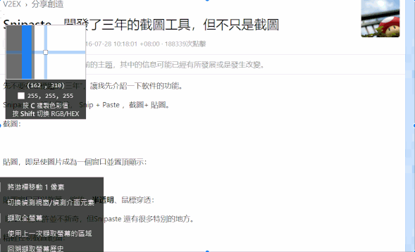

> 用對工具，提升效率！

---

## 假業配，真推薦

自從某次看到同事用這個截圖軟體，

不看還好，一看驚為天人！！（微浮誇）

雖然已經有很多高手們推薦過，

但因為實在太喜歡它，

總想著，如果我有部落格，我也要來推薦一下，

於是就有了這篇文章。

那麼，它揪竟有多厲害呢？

讓我們繼續看下去～

---

## 本日主角：Snipaste

（目前 v1 是免費使用，v2 個人免費使用，若商業用需要付費，

若有錯誤可以再留言更正一下，謝謝！！）

作者 levie 說：

> Snipaste，顧名思義，Snip + Paste，截圖+ 貼圖。

（出發點是以貼圖工具為主）

簡易 Demo：

1. 截圖（可自定義快捷鍵）+ 貼圖（Ctrl+T 做成貼圖）
2. 螢光筆（用框的，不怕手殘畫歪）
3. 箭頭
4. 文字
5. 滑鼠滾輪控制貼圖大小
6. Ctrl+滑鼠滾輪控制透明度

（P.S. Gif 檔是用 [LICEcap](https://www.cockos.com/licecap/) 錄製的）

- [下載連結](https://zh.snipaste.com/download.html)

- [使用手冊](https://docs.snipaste.com/zh-cn/getting-started)

---

## 沒有好與壞，只有適不適合

每個人都有自己喜歡的、適合的工具，

很難有一個工具可以直接符合 100% 的需求，

但只要用得習慣，能幫助你節省時間，

那就很值得了！
